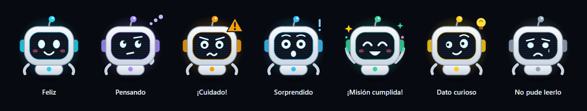

# 🔬 PaperLab WebAR

> **Transforma dibujos a mano en papel físico en simulaciones científicas interactivas con Realidad Aumentada (WebAR).**

PaperLab es un sistema educativo que permite a estudiantes y docentes dibujar bocetos científicos (planos inclinados, circuitos eléctricos con grafito, algoritmos o figuras geométricas) en sus cuadernos físicos. A través de la cámara del celular, el sistema analiza los trazos con Inteligencia Artificial multimodal y superpone simulaciones holográficas interactivas en tiempo real.

---

## 🏛️ Arquitectura General

El proyecto cuenta con una separación limpia y desacoplada entre dos componentes principales:

```
PaperLab/
├── frontend/   ← Aplicación WebAR (React 19 + Vite + TypeScript + Tailwind CSS v4)
└── backend/    ← Backend de Análisis IA (FastAPI + Modular Monolith + Google Gemini)
```

1. **Frontend (`frontend/`):** Desarrollado en **React 19**, **Vite**, **TypeScript** y **Tailwind CSS v4**. Gestiona la interfaz del laboratorio, la selección de disciplinas y el visor WebAR con acceso a la cámara del dispositivo móvil, efectos holográficos y sonido.
2. **Backend (`backend/`):** Desarrollado en **FastAPI** con arquitectura de **Modular Monolith** (vertical slices). Preprocesa las fotografías, consulta a **Google Gemini** con salida estructurada estricta y valida contratos físicos determinísticos para alimentar a los simuladores.

---

## 📋 Requisitos Previos

- **Node.js** v18 o superior y **npm** (para el Frontend).
- **Python** 3.10 a 3.14 (para el Backend). En 3.15 todavía no hay ruedas de `pyyaml` (dependencia de `uvicorn[standard]`) y la instalación falla.
- Clave de API de **Google Gemini** (gratuita en [Google AI Studio](https://aistudio.google.com/)).

---

## 🎨 1. Instalación y Ejecución del Frontend

El frontend se encuentra en la carpeta `frontend/`.

### Paso 1: Entrar a la carpeta e instalar dependencias
```bash
cd frontend
npm install
```

### Paso 2: Iniciar el servidor de desarrollo
```bash
npm run dev
```

El frontend quedará activo en:
👉 **`http://localhost:5173`** (y en `http://<IP-de-tu-PC>:5173` para probar desde el celular en la misma red)

> 🔌 **Conexión con el backend:** el frontend envía las fotos a `/api/analyze/{módulo}`. En desarrollo, Vite redirige `/api/*` a `http://localhost:8000` (ver `frontend/vite.config.ts`), así que **el backend debe estar corriendo**. En producción define `VITE_API_URL` con la URL pública del backend.

### Scripts disponibles del Frontend:
- `npm run dev`: Inicia el servidor de desarrollo con Hot Module Replacement (HMR).
- `npm run dev:https`: Igual, pero por HTTPS con certificado local. **Úsalo para probar desde el celular**: los navegadores móviles solo permiten la cámara en contextos seguros (acepta el aviso del certificado la primera vez).
- `npm run build`: Compila la aplicación para producción con TypeScript.
- `npm run lint`: Ejecuta el linter ultrarrápido con Oxlint.
- `npm run preview`: Previsualiza la versión compilada de producción.

---

## ⚙️ 2. Instalación y Ejecución del Backend

El backend se encuentra dentro de la carpeta `backend/`.

### Paso 1: Crear y activar entorno virtual Python
Desde la raíz del proyecto (`PaperLab/`) o dentro de `backend/`:

**En Windows (PowerShell):**
```powershell
python -m venv .venv
.\.venv\Scripts\Activate.ps1
```

**En Linux / macOS:**
```bash
python3 -m venv .venv
source .venv/bin/activate
```

### Paso 2: Instalar dependencias de Python
Entra a la carpeta `backend` e instala los requerimientos:
```bash
cd backend
pip install -r requirements.txt
```

*(Instala `fastapi`, `uvicorn`, `google-genai`, `pydantic`, `pillow`, `truststore`, etc.)*

### Paso 3: Configurar variables de entorno (`.env`)
En la carpeta `backend/`, copia la plantilla `.env.example` a `.env` (si aún no existe):
```bash
cp .env.example .env
```

Edita `backend/.env` colocando tu clave de API:
```env
# Tu API Key de Google Gemini (solo vive en el backend, nunca en el frontend)
GEMINI_API_KEY=tu_api_key_aqui
GEMINI_MODEL=gemini-3.8-flash
# Modelos alternativos si el principal está saturado (503) o no disponible
GEMINI_FALLBACK_MODELS=gemini-3.5-flash,gemini-3.5-flash-lite

# Umbral de confianza mínimo aceptado (0.0 a 1.0)
CONFIDENCE_THRESHOLD=0.8

# Tamaño máximo de imagen permitido en MB
MAX_IMAGE_SIZE_MB=10

# Límite de tiempo en segundos
LLM_TIMEOUT_SECONDS=60

# Número máximo de reintentos automáticos ante inconsistencias
MAX_RETRIES=1

# Orígenes CORS permitidos (en desarrollo el frontend usa el proxy de Vite)
CORS_ORIGINS=http://localhost:5173,http://127.0.0.1:5173
```

> ⚠️ `backend/.env` está en `.gitignore`. **Nunca** pongas keys reales en el README, en `.env.example` ni en variables `VITE_*` (estas se incrustan en el JavaScript que recibe el navegador).

### Paso 4: Iniciar el servidor Backend
Estando dentro de la carpeta `backend/`:
```bash
uvicorn main:app --reload --host 0.0.0.0 --port 8000
```

El servidor quedará disponible en:
👉 **`http://localhost:8000`**

Documentación interactiva de la API (Swagger UI):
👉 **`http://localhost:8000/docs`**

---

## 🧠 Los 4 Módulos y los 23 Ejercicios Soportados

| Módulo (`skill_id`) | Total | Tipos incluidos en el Contrato (`exercise_type`) |
|---|:---:|---|
| **`physics`** (Física) | **6** | `inclined_plane` (Plano inclinado con fricción), `simple_pendulum` (Péndulo simple), `projectile_motion` (Tiro parabólico), `mass_spring` (Ley de Hooke), `rectilinear_motion` (Cinemática MRU/MRUV), `atwood_machine` (Poleas de Atwood) |
| **`circuit`** (Circuitos) | **6** | `single_loop` (Malla simple con bombilla/LED), `series_resistors` (Resistencias en serie), `parallel_resistors` (Resistencias en paralelo), `interactive_switch` (Interruptor táctil), `rc_circuit` (Carga/descarga de condensador), `logic_gates` (Compuertas AND, OR, NOT...) |
| **`flowchart`** (Algoritmos) | **6** | `sequential_flowchart` (Diagrama secuencial), `conditional_flowchart` (Bifurcaciones IF/ELSE), `loop_flowchart` (Bucles While/For), `code_debugger` (Depurador paso a paso), `trace_table` (Tabla de traza de variables), `recursive_flowchart` (Recursión y call stack) |
| **`math_geo`** (Matemáticas) | **5** | `geometry_3d` (Estereometría 3D sobre papel), `analytic_geometry` (Plano cartesiano y rectas), `function_graph` (Gráfica de funciones f(x)), `equation_solver` (Solver paso a paso con discriminante), `geometric_angles` (Cálculo de incógnitas angulares en figuras) |

---

## 🪄 Solver AR sobre el papel (Matemáticas)

Flujo: el alumno encuadra su hoja → **Escanear y resolver** congela la captura → la IA lee la ecuación → la solución se escribe a mano sobre la foto, paso a paso, con su gráfica si hay espacio. **Escanear** vuelve a la cámara en vivo.

> **Modo por defecto: foto congelada** (100 % estable, ideal para demos). El rastreo en vivo sobre la hoja (flujo óptico + MindAR) es **experimental** y se activa abriendo la app con `?ar=live` (ej. `http://localhost:5173/?ar=live`).

| Pieza | Archivo | Qué hace |
|---|---|---|
| Visión de la hoja | `frontend/src/ar/paperVision.ts` | Segmenta la hoja y los trazos; mide color de la tinta (reflectancia vs. papel), grosor del trazo, tipo (grafito / lapicero) y altura de letra. |
| Motor matemático | `frontend/src/ar/mathEngine.ts` | Interpreta la ecuación (texto plano o LaTeX) y calcula pasos, raíces y gráfica de forma determinística: la IA solo transcribe, nunca inventa números. |
| Escritura a mano | `frontend/src/ar/handwriting.ts` | Fuente Caveat + **rough.js** para fracciones, raíces, Δ, ejes y curva con aspecto de lápiz. |
| Layout | `frontend/src/ar/arLayout.ts` | Escribe debajo de lo que escribió el alumno, a su misma escala; ubica la gráfica en el espacio libre de la hoja. |
| Rastreo | `frontend/src/ar/paperTracker.ts` | Flujo óptico Lucas-Kanade (**jsfeat**) + RANSAC con realineación contra la captura (sin deriva); **MindAR** como relocalizador cuando la hoja se pierde. |
| Render | `frontend/src/ar/arScene.ts` | **Three.js** con homografía en pantalla y `mix-blend-mode: multiply`: la tinta virtual hereda la luz, sombras y textura del papel real. |

Los **23 tipos** tienen solución o simulación interactiva sobre la hoja (`frontend/src/sims/`): física, circuitos, debugger de algoritmos y figuras matemáticas. Los valores se recalculan siempre con los datos de entrada: nunca se anima un número mal calculado por la IA.

---

## 🧠 Tutor Socrático "Lumi"



Lumi es un avatar holográfico (SVG propio, 0 KB de imágenes) que **siempre está en la cámara**: saluda, da consejos de encuadre, comenta cada resultado, cuenta datos curiosos verificables y propone retos. Tiene 7 expresiones y mueve la boca mientras habla.

Cuando el alumno se equivoca, la app **no falla ni devuelve un error 400**: superpone un **holograma de advertencia** sobre el dibujo y Lumi hace una **pregunta socrática** (con pista opcional), sin darle la solución.

| Error del alumno | Código | Pregunta de Lumi |
|---|---|---|
| Cable directo entre (+) y (−) | `short_circuit` | ¿Qué ocurriría con la batería si cerramos este circuito? |
| Malla interrumpida | `open_circuit` | ¿Qué necesita un circuito para que la corriente circule de forma continua? |
| LED sin resistencia | `led_overcurrent` | ¿Qué resistencia mínima necesitas para no superar 20 mA? |
| Rampa con ángulo negativo | `negative_angle` | ¿Qué valores puede tomar el ángulo para que siga siendo una rampa? |
| μ ≥ tan θ (el bloque no desliza) | `static_friction` | ¿Qué ángulo mínimo necesitas para que comience a deslizar? |
| Fricción o aceleración dibujada al revés | `inverted_force` | Si la fricción se opone al movimiento, ¿hacia dónde debe apuntar? |
| Bucle cuya variable nunca cambia | `infinite_loop` | ¿Qué instrucción haría que la condición algún día sea falsa? |
| Ángulos que ya suman ≥ 180° | `impossible_triangle` | ¿Cuánto espacio le queda al tercer ángulo? |
| Raíz real con Δ < 0 | `no_real_roots` | ¿Qué le pasa a √ de un número negativo en los reales? |

**Cómo funciona:**
- Todos los contratos Pydantic incluyen el campo `tutor` (`pedagogical_feedback`, `socratic_challenge`, `hint`, `fun_fact`, `mood`, `has_error`, `error_type`, `mistakes`). Las instrucciones comunes están en `backend/modules/analysis/domain/skills/tutor_prompt.md`; cada `prompt.md` lista los errores típicos de su módulo.
- Los esquemas permiten reportar el dibujo **tal como está** (ángulos negativos, R = 0, `circuit_closed = false`, `student_solution`…), así el LLM no "corrige" el error del alumno.
- `backend/modules/analysis/domain/pedagogy.py` detecta los errores con **reglas determinísticas**. Si el LLM no comentó un error, el backend le pide **una** verificación de lectura (¿lo dibujó así el alumno o fue OCR?) y, si se confirma, escribe él mismo la retroalimentación con los números exactos.
- `validators.py` queda solo para incoherencias del LLM (listas desalineadas, flechas a nodos inexistentes…), que sí provocan reintento.

## 🔊 Audio-Explicación STEM (accesibilidad)

Botón **🔊 Escuchar** en el panel AR y en el globo de Lumi. Usa la Web Speech API nativa (`window.speechSynthesis`, 0 KB de dependencias) con voz en español.

> "Simulación en curso: Péndulo simple. El péndulo de 1,5 metros oscila con un período de 2,46 segundos. Su velocidad máxima es de 1,33 metros por segundo en el punto de equilibrio. Telemetría en este instante: …"

- `frontend/src/a11y/narration.ts` describe cada uno de los 23 fenómenos en lenguaje natural, lee la **telemetría en vivo** y convierte unidades y símbolos en palabras (m/s² → "metros por segundo al cuadrado", θ → "theta", Ω → "ohmios").
- `frontend/src/a11y/speech.ts` trocea el texto en frases (Chrome corta locuciones largas) y anima la boca de Lumi mientras habla.
- En el perfil se puede activar la **lectura automática** de cada simulación y de cada mensaje del tutor. Las animaciones respetan `prefers-reduced-motion`.

## 🎯 Modo Reto / Misiones (gamificación en papel)

El sistema propone misiones que el alumno resuelve **dibujando en su cuaderno**. Tras escanear, la condición se evalúa de forma determinística (recalculando la física con los datos leídos) y, si se cumple, aparece un **sello holográfico "¡Misión Cumplida! +100 XP" con confeti**.

| Módulo | Misiones |
|---|---|
| Física | La bandera a 12 metros (tiro parabólico) · El péndulo que marca segundos (T = 2 s) · El bloque que no se rinde (equilibrio estático) |
| Circuitos | Un interruptor, dos destinos (apaga un LED y deja el otro encendido) · LED a salvo (10–25 mA) |
| Algoritmos | La suma de Gauss (salida 55) · ¿Par o impar? |
| Matemáticas | Vértice en (2, −1) · La lata de un litro |

- **XP y 8 niveles**, **14 logros**, **racha diaria** 🔥 y **misión del día** (×2 XP). Todo se guarda en el dispositivo (`localStorage`), sin cuentas.
- **Notificaciones**: toasts en la app y, si el alumno las activa en su perfil, **notificaciones del sistema** (Notification API + Service Worker `public/sw.js`) para logros, niveles y misiones.
- Si la misión no se cumple, Lumi dice cuánto falta ("tu proyectil cae a 10.2 m: te faltan 1.8 m") y hace una pregunta para el siguiente intento.
- Código: `frontend/src/game/` (`missions.ts`, `progress.ts`, `notify.ts`, `GameUI.tsx`).

---

## 🧪 Pruebas

### Backend (unitarias + contrato + API con LLM simulado)
```bash
cd backend
python -m unittest discover -s tests
```
Incluye la detección de cada error pedagógico, que un error del alumno devuelve **200 con pregunta socrática** (no 400/422), y un **test de contrato** que valida los 65 JSON de `ejemplos/` contra los esquemas Pydantic reales.

### End-to-end (Playwright, navegador real)
```bash
cd frontend
npx playwright install chromium   # solo la primera vez
npm run test:e2e
```
Levanta el **backend real** con un LLM simulado (`backend/tests/e2e_server.py`) y el frontend con cámara falsa de Chromium. Recorre los 65 ejemplos de los 4 módulos (nivel 1, nivel 2, errores y misiones), sube fotos al backend, comprueba el holograma y la pregunta socrática, la audio-explicación, las misiones (sello, XP, logros) y el perfil, en escritorio y móvil (`@mobile`). Con un Chrome instalado se puede usar `PW_CHANNEL=chrome npm run test:e2e`.

### Regenerar los ejemplos
```bash
cd frontend
npm run export:examples           # JSON de todos + fotos que falten + imágenes de Lumi (docs/lumi/)
npm run export:examples -- --photos   # también vuelve a dibujar todas las fotos
```

---

## 📁 Estructura del Repositorio

```
PaperLab/
├── frontend/                        ← Aplicación WebAR en React 19 + Vite
│   ├── public/                      ← Assets estáticos y favicon
│   ├── src/                         ← Código fuente React (Componentes, Visor WebAR, Theme)
│   │   ├── components/              ← ARCameraView, ModuleSelector, SplashScreen, Header, etc.
│   │   ├── tutor/                   ← Lumi: avatar SVG, globo de diálogo, datos curiosos
│   │   ├── a11y/                    ← Audio-explicación (Web Speech API) y narrador STEM
│   │   ├── game/                    ← Misiones, XP, niveles, logros y notificaciones
│   │   ├── sims/                    ← Simulaciones de los 23 tipos de ejercicio
│   │   ├── demo/                    ← Ejemplos (foto + JSON) y guiones del tutor
│   │   ├── data/                    ← Paletas de colores y configuración
│   │   └── utils/                   ← Efectos de sonido y utilidades WebAR
│   ├── package.json                 ← Dependencias y scripts del frontend
│   ├── e2e/                         ← Pruebas end-to-end (Playwright)
│   ├── scripts/                     ← Exportación de ejemplos e imágenes de Lumi
│   └── vite.config.ts               ← Configuración de Vite y Tailwind v4
│
├── backend/                         ← Monolito modular FastAPI
│   ├── main.py                      ← Entrada FastAPI, CORS y endpoints base
│   ├── config.py                    ← Ajustes tipados con Pydantic Settings
│   ├── .env.example                 ← Plantilla de variables de entorno
│   ├── requirements.txt             ← Dependencias oficiales de Python
│   ├── shared/                      ← Excepciones, tipos comunes y logging
│   ├── modules/
│   │   └── analysis/                ← Módulo vertical de análisis (API, Service, Skills, Adapters)
│   │   │   ├── domain/skills/       ← Especialistas: physics, circuit, flowchart, math_geo (+ tutor_prompt.md)
│   │   │   ├── domain/pedagogy.py   ← Tutor Socrático: detección determinística de errores del alumno
│   │   │   ├── adapters/            ← Adaptador Google Gemini (SDK google-genai)
│   │   │   └── ports/               ← Interfaz abstracta LLMClient
│   └── tests/                       ← Tests unitarios, de contrato y servidor e2e
│
├── ejemplos/                        ← Fotos + JSON: nivel 1, nivel 2, errores y misiones
├── docs/lumi/                       ← Expresiones del avatar Lumi (SVG + PNG)
├── RUBRICA_EJERCICIOS.md            ← Catálogo canónico oficial de ejercicios de PaperLab
└── README.md                        ← Este documento
```
